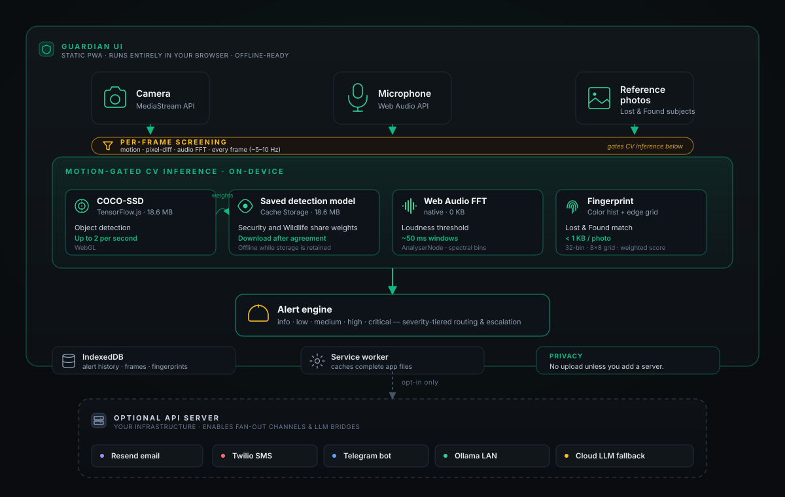

# SafeOS Guardian

<div align="center">
  

  <p><strong>Motion and sound alerts for pets, babies, and elderly care, in your browser, with person and animal detection in Security and Wildlife.</strong></p>

  <p>
    <a href="https://safeos.sh">safeos.sh</a> ·
    <a href="https://frame.dev">frame.dev</a> ·
    <a href="https://wilds.ai/discord">Discord</a>
  </p>

  [](https://opensource.org/licenses/MIT)
  [](https://www.typescriptlang.org/)
  [](https://codecov.io/gh/framerslab/safeos)
  [](https://web.dev/articles/progressive-web-apps)
  [](https://frame.dev)
</div>

---

## ⚠️ Not a replacement for human supervision

SafeOS Guardian is a **supplemental experimental tool**. It adds an alert and does not replace a person nearby. SafeOS is not a medical device: it does not monitor breathing and cannot prevent SIDS. Technology fails. Maintain direct supervision of children, pets, and elderly family members at all times.

---

## What it is

SafeOS Guardian is a Progressive Web App that turns any device with a camera and microphone into a monitoring station. It compares video frames and sound levels in the browser, runs the [TensorFlow.js](https://www.tensorflow.org/js) COCO-SSD model on-device in its Security and Wildlife modes, and raises severity-tiered alerts. In the browser-only setup no frames leave the device, the app loads no analytics or tracking script, and no account is needed.

Choose a camera on Setup or Monitor; the choice is remembered in this browser. Monitor requests capture only when you start it, releases capture when you stop, and reports camera failures. Local processing sends no camera frames to a connected server. Monitor alerts persist in IndexedDB and reload in History. See [Camera monitoring](docs/MONITORING.md).

After the service worker finishes installing, the exported pages and their scripts are available offline, including pages not yet opened. Complete setup and choose **Download detection model** on Security, Wildlife, or Settings → Models to save COCO-SSD for offline use. Initial installation and model download need a connection; clearing or evicting browser storage removes those copies.

## Quickstart

**Fastest — pull the prebuilt images (no clone, no build):**

```bash
# downloads ONLY the compose file (the run recipe, ~120 lines of YAML — not source code)
curl -O https://raw.githubusercontent.com/framerslab/safeos/master/docker-compose.ghcr.yml
docker compose -f docker-compose.ghcr.yml up -d
```

`docker compose` then pulls the prebuilt images `ghcr.io/framerslab/safeos-api` and `…/safeos-ui` (nothing is compiled locally), downloads and caches the Ollama vision models, and starts everything. UI at <http://localhost:3000>, API at <http://localhost:3001>.

Or pull the images straight from the registry with the Docker CLI:

```bash
docker pull ghcr.io/framerslab/safeos-api:latest
docker pull ghcr.io/framerslab/safeos-ui:latest
```

The two images run together: `safeos-ui` is the interface you open, `safeos-api` is the backend it talks to for notifications and the local-AI bridge. The compose starts both, plus Ollama, and wires them on one network. (`docker run … safeos-api` on its own gives you just the headless API.)

**Local AI with Ollama:** the compose runs an Ollama container and pre-pulls its models on first start, so local scene analysis works with no extra setup. To use an Ollama instance you already run, set `OLLAMA_HOST` in `.env` (e.g. `http://192.168.1.50:11434`). Choose which models to cache with `OLLAMA_MODELS` (default `moondream llava:7b`; add `llama3.2-vision:11b` if you have ~16 GB RAM). Frames reach the server, and so Ollama, only in a processing mode that uses the server. With no cloud AI key in `.env` they stay on your network; with one, the server sends a frame to that provider when Ollama is down or its analysis fails. Details in [docs/DOCKER.md](docs/DOCKER.md).

**Build from source instead:**

```bash
git clone https://github.com/framerslab/safeos.git
cd safeos
cp .env.example .env            # optional — add only the keys you want
docker compose up -d --build
```

NVIDIA GPU: add `-f docker-compose.gpu.yml` to either command. Full reference and troubleshooting: [docs/DOCKER.md](docs/DOCKER.md).

**Browser PWA only (no server, no Docker):**

```bash
cd apps/guardian-ui
npm ci
npm run dev                        # http://localhost:3000
```

COCO-SSD downloads on first use of Security or Wildlife mode.

## Part of the Frame ecosystem

SafeOS Guardian is built by [Frame](https://frame.dev) — the same team behind [AgentOS](https://agentos.sh), an open-source agent runtime with cognitive memory grounded in HEXACO personality traits, and [Paracosm](https://paracosm.agentos.sh), an agent swarm simulation engine where AI characters with persistent memory inhabit shared world models. Same local-first philosophy: deep learning that runs on the user's device, not in someone else's cloud.

If you want to dig deeper:

- [Frame](https://frame.dev) — the company building local-first AI runtimes
- [AgentOS](https://agentos.sh) — the agent framework, currently scoring [85.6% on LongMemEval-S](https://agentos.sh/en/blog/agentos-memory-sota-longmemeval/) with built-in PII redaction and configurable guardrails
- [Paracosm](https://paracosm.agentos.sh) — agent swarm simulation with [citation-verified events](https://docs.agentos.sh/features/citation-verification)
- [github.com/framerslab](https://github.com/framerslab) — all the open-source repos

## Use cases

| Scenario | What SafeOS Guardian does |
|---|---|
| **Pet monitoring** | Motion, loud sound, and prolonged stillness. |
| **Baby & toddler** | Sustained motion, small movements, loud sound, and inactivity. |
| **Elder care** | Prolonged inactivity, motion, and loud sound. |
| **Lost & Found** | Watch your own camera for an animal with a lost pet's colouring, from 1–5 reference photos (color + edge fingerprints). It does not identify a pet. |
| **Wildlife & outdoor** | Backyard trail-cam, livestock, and animal detection with COCO-SSD. |
| **Authority / emergency** | At-risk areas or shelters; severity-routed alerts via the optional server. |
| **Small-business security** | Perimeter watch, after-hours intrusion, customer-traffic counts. Escalating push + audio. |
| **Personal safety** | Lone-worker check-ins; doorbell detection for d/Deaf households; live-in caregiving. |

SafeOS is a **supplemental** tool. It augments human attention; it does not replace it. Privacy laws around recording vary by jurisdiction — only deploy on premises and people you have authority to monitor.

## Architecture



The solid path runs in the browser; offline starts require completed app installation and, for detection, a saved model. The dashed path engages only when you deploy the optional API server and opt into individual integrations.

## How the deep learning runs in your browser

1. **First load.** The Next.js app shell loads from any static host (GitHub Pages, Vercel, Netlify, Cloudflare Pages). The service worker registers after the first page loads and installs a build-specific set of HTML, scripts (including lazy chunks), styles, fonts, and the images the pages show. A new build activates after tabs using the previous worker close.
2. **Model fetch.** After setup and explicit agreement, TensorFlow.js downloads COCO-SSD `lite_mobilenet_v2` from Google's [`tfjs-models`](https://github.com/tensorflow/tfjs-models/tree/master/coco-ssd) storage (18.6 MB including the manifest). One shared loader saves the manifest and every weight shard in Cache Storage and reuses them offline. Failed attempts can be retried without reloading the page.
3. **Backend.** SafeOS sets TF.js to the [WebGL](https://www.khronos.org/webgl/) backend (`tf.setBackend('webgl')`).
4. **Per-frame screening.** A `setInterval` loop at 200 ms samples the `<video>` element into a hidden `<canvas>`, runs pixel-diff motion detection and an FFT pass over the Web Audio `AnalyserNode`, and tracks pixel-change counts. Cheap enough to run continuously without a GPU context. Code: [`apps/guardian-ui/src/components/CameraFeed.tsx`](apps/guardian-ui/src/components/CameraFeed.tsx).
5. **Gated inference.** In Security mode, when motion crosses the threshold the frame is handed to TF.js; COCO-SSD's `model.detect()` returns bounding boxes, class labels, and confidence, at most once every 500 ms. The monitor page runs no model. Gate: [`apps/guardian-ui/src/lib/person-detection.ts`](apps/guardian-ui/src/lib/person-detection.ts).
6. **Model settings.** Settings → Models downloads the same COCO-SSD model used by Security and Wildlife. It offers no separate scene classifier download.
7. **Audio parallel path.** The Web Audio API's [`AnalyserNode`](https://developer.mozilla.org/en-US/docs/Web/API/AnalyserNode) samples FFT bins from the microphone every ~100 ms; a loudness threshold raises the sound alert, and a crying pattern shows in the camera overlay without raising an alert of its own. No model needed.
8. **Lost & Found fingerprinting.** Reference photos reduce to a 32-bin color histogram, top-5 dominant colors (k-means), an 8×8 grid of edge strengths taken from differences between neighbouring pixels, and a size estimate. The matcher samples the live feed at 1–2 FPS and scores each frame on average colour, then region by region on a weighted mix (histogram 40%, dominant colours 35%, edges 15%, size 10%). It matches colours, so another animal or an object of similar colour matches too. Under 1 KB per photo. Code: [`apps/guardian-ui/src/lib/visual-fingerprint.ts`](apps/guardian-ui/src/lib/visual-fingerprint.ts).
9. **Alert engine.** Matches feed a severity router (info / low / medium / high / critical). Each severity has its own escalation: volume-ramping local audio, browser push, optional fan-out to email / SMS / Telegram via the API server.
10. **Storage stays local.** Settings persist in local storage; fingerprints and saved frames persist in [IndexedDB](https://developer.mozilla.org/en-US/docs/Web/API/IndexedDB_API). Monitor-page alerts are saved in IndexedDB and restored in History after a reload. The motion check keeps only the last three frames in memory.

The optional API server (`src/`) only enters the picture when you opt into fan-out channels (Resend, Twilio, Telegram), multi-device WebSocket sync, or a bridge to a local [Ollama](https://ollama.com) install for richer scene reasoning.

## Models

Every model runs client-side. Sizes are the download sizes measured on 11 Nov 2026.

| Job | Model | Framework | Size | Source |
|---|---|---|---|---|
| Object detection (Security and Wildlife modes) | COCO-SSD (`lite_mobilenet_v2`) | [TensorFlow.js Models](https://github.com/tensorflow/tfjs-models/tree/master/coco-ssd) | 18.6 MB | tfjs-models |
| Audio analysis | FFT bins via [Web Audio API](https://developer.mozilla.org/en-US/docs/Web/API/Web_Audio_API) | native | 0 KB | MDN |
| Visual fingerprinting | Color histograms + edge grid | hand-rolled | < 1 KB / photo | [`apps/guardian-ui/src/lib/visual-fingerprint.ts`](apps/guardian-ui/src/lib/visual-fingerprint.ts) |

### Optional: local LLM for harder scenes

In a processing mode that uses the server, the monitor sends camera frames to the API server, which analyses them with a local [Ollama](https://ollama.com) install. With no cloud AI key set, frames stay on your LAN.

| Model | Size | Latency | Use |
|---|---|---|---|
| [`moondream`](https://ollama.com/library/moondream) | ~1.7 GB | ~500 ms | Fast triage |
| [`llava:7b`](https://ollama.com/library/llava) | ~4 GB | 2–5 s | Detailed analysis |
| [`llama3.2-vision:11b`](https://ollama.com/library/llama3.2-vision) | ~7 GB | 5–10 s | Complex reasoning |

### Optional: cloud fallback

When Ollama is down or its analysis of a frame fails, the API server sends that frame to the cloud providers with a key in `.env`, one after another in this order, until one answers; a frame can therefore reach more than one provider when the first fails ([`src/lib/analysis/cloud-fallback.ts`](src/lib/analysis/cloud-fallback.ts)):

- `google/gemini-2.5-flash` via [OpenRouter](https://openrouter.ai) (`OPENROUTER_API_KEY`)
- `gpt-5.6-terra` via [OpenAI](https://platform.openai.com) (`OPENAI_API_KEY`)
- `claude-haiku-5-5` via [Anthropic](https://www.anthropic.com) (`ANTHROPIC_API_KEY`)

With none of these keys set, no frame goes to a cloud provider.

## Notification channels

SafeOS Guardian fans out alerts across four channels, routed by severity:

| Severity | Browser push | Email (Resend) | SMS (Twilio) | Telegram |
|---|:---:|:---:|:---:|:---:|
| info / low | ✓ | — | — | — |
| medium | ✓ | ✓ | — | ✓ |
| high | ✓ | ✓ | ✓ | ✓ |
| critical | ✓ | ✓ | ✓ | ✓ |

Browser push works straight from the static PWA. Email via [Resend](https://resend.com), SMS via [Twilio](https://www.twilio.com), and Telegram via a [bot](https://core.telegram.org/bots) fan out from the optional API server — those three providers can't be called safely from the browser (no CORS, and the keys would leak in client JS), so the server is what holds the credentials and makes the outbound calls. All three integrations are opt-in.

### Email alerts via Resend

[Resend](https://resend.com) sends severity-routed alert email when something matches. Free tier covers 3,000 emails/month.

Two ways to wire it up:

1. **Server-wide key (operator pays).** Set `RESEND_API_KEY`, `EMAIL_FROM`, `EMAIL_REPLY_TO` and `SAFEOS_API_PUBLIC_URL` in the API server's `.env`. The server sends alert email with this key only for the operator's own account (the profile with the operator role). Transactional auth email (verification + reset) requires this path.
2. **Your own key, for the test email.** In the app, go to **Settings → Notifications**, toggle on email alerts, and enable **Use my own Resend account**. Paste a Resend API key and a verified sender. The page sends the key with the test email and does not save it, so alerts do not use it. For an account that is not the operator's, alert email needs a personal key saved in that profile's notification settings through the API (`emailOverride`).

Alert email goes out only when the profile has email turned **on** and a recipient set. The settings page's test sends one email; saving that page does not turn on alert email. See [`apps/guardian-ui/src/app/help/integrations/resend`](apps/guardian-ui/src/app/help/integrations/resend) for the full setup walkthrough or read [`src/lib/alerts/email.ts`](src/lib/alerts/email.ts) for the implementation.

#### Unsubscribe link in every mail

Every mail the API server sends (alerts, the settings test message, account verification and password reset) ends with a visible **Unsubscribe** link and carries the `List-Unsubscribe` and `List-Unsubscribe-Post: List-Unsubscribe=One-Click` headers ([RFC 8058](https://datatracker.ietf.org/doc/html/rfc8058)), so Gmail, Yahoo and Apple Mail can show their own unsubscribe button.

- The link points at this server: `<SAFEOS_API_PUBLIC_URL>/api/mail/unsubscribe/<token>`. Set `SAFEOS_API_PUBLIC_URL` to the API server's https address; behind the bundled Caddy, `SAFEOS_DOMAIN` is used when it is unset. Without an https address the server sends no mail and `/api/notifications/test-email` says why.
- Opening the link shows a page that asks and changes nothing. The page's button, or a mailbox's one-click POST, stops the mail at once. No mail is sent to confirm it.
- Alert email and the settings test message stop for that address. Account mail (verification, password reset) is sent only when someone asks for it; its link opens a page that turns off every optional mail and says what still comes.
- The token in the link is bound to one recipient and reveals nothing: random, or, when the mail has an idempotency key, derived from that key with a secret kept in the database, so a retried send carries the same link. The server stores only its SHA-256 and the SHA-256 of the address.
- To stop all mail to an address, account mail included, pipe it in: `docker compose exec -T api npx tsx src/cli/mail-suppress.ts < addresses.txt` (one address per line; the command prints counts only). When a person who unsubscribed asks for mail again, the same command with `--resubscribe` lifts their unsubscribe; a manual stop stays.
- The API's request log and the bundled Caddy's access log print `[token]` in place of the token.
- Mailbox providers act on the one-click header only when the mail's DKIM signature covers it. After setting up your sending domain, open a received mail's original source and check that the `h=` list of its `DKIM-Signature` includes `list-unsubscribe` and `list-unsubscribe-post`.

## Privacy guarantees

- **Three frames.** The motion check keeps only the last three frames in memory.
- **No cloud uploads** in PWA-only mode. Period.
- **No telemetry.** The app loads no analytics or tracking script and uploads nothing for model training.
- **Browser storage only.** Settings, saved frames, and reference photos stay in [browser-local storage](https://developer.mozilla.org/en-US/docs/Web/API/IndexedDB_API).
- **Optional integrations are opt-in.** Twilio, Telegram, Ollama, and cloud fallback fire only when you configure them.

## Running from source

The Quickstart above is the fast path. To run the pieces directly with npm:

```bash
npm install --legacy-peer-deps
(cd apps/guardian-ui && npm ci)
npm run dev          # API (3001) + UI (3000) together
# or run them separately:
npm run api      # API on 3001
npm run ui       # UI on 3000
```

Static PWA build — deploy `apps/guardian-ui/out` to any CDN:

```bash
npm run build:ui     # writes apps/guardian-ui/out
```

Local LLM (optional) — point `OLLAMA_HOST` at your install:

```bash
brew install ollama         # macOS; see ollama.com for other platforms
ollama serve
./scripts/pull-ollama-models.sh   # pulls moondream + llava:7b
```

## Configuration

Copy [`.env.example`](.env.example) to `.env`. Every variable is optional unless you deploy the API server.

```env
# Local LLM
OLLAMA_HOST=http://localhost:11434

# Cloud fallback (only configure what you want to use)
OPENROUTER_API_KEY=sk-or-...
OPENAI_API_KEY=sk-...
ANTHROPIC_API_KEY=sk-ant-...

# Server-side notifications
TWILIO_ACCOUNT_SID=AC...
TWILIO_AUTH_TOKEN=...
TWILIO_FROM_NUMBER=+1...
TELEGRAM_BOT_TOKEN=...

# Email alerts via Resend (optional, recommended)
RESEND_API_KEY=re_...
EMAIL_FROM="SafeOS Guardian <alerts@yourdomain.com>"
EMAIL_REPLY_TO="team@yourdomain.com"
# https address of this API server; every mail's unsubscribe link points here
SAFEOS_API_PUBLIC_URL=https://safeos-api.yourdomain.com

# Browser push (requires the API server to sign payloads)
VAPID_PUBLIC_KEY=...
VAPID_PRIVATE_KEY=...
```

Sensitivity thresholds live in [`src/lib/analysis/profiles/`](src/lib/analysis/profiles/). Each scenario has its own profile.

## Project layout

```
safeos/
├── apps/guardian-ui/        # Next.js PWA — runs the models in your browser
│   └── src/
│       ├── app/             # Routes (dashboard, monitor, history, settings)
│       ├── components/      # CameraFeed, AlertPanel, LostFoundSetup, …
│       ├── lib/             # visual-fingerprint, motion-detection, websocket
│       └── stores/          # Zustand stores (monitoring, lost-found, onboarding)
│
├── src/                     # Optional Express API
│   ├── api/                 # HTTP + WebSocket routes
│   ├── lib/
│   │   ├── analysis/        # Frame analyzer + cloud fallback
│   │   ├── alerts/          # Escalation, Twilio, Telegram, browser push
│   │   ├── audio/           # Distress / cry detection
│   │   ├── ollama/          # Local LLM client
│   │   └── webrtc/          # Signaling
│   └── queues/              # Job queues (analysis, human review)
│
├── tests/                   # vitest — unit + integration
├── docker-compose.yml       # Full stack: UI + API + Ollama + model cache
├── docker-compose.prod.yml  # Production (Caddy HTTPS)
├── docker-compose.gpu.yml   # NVIDIA GPU override
└── Dockerfile               # Multi-stage: backend (tsx), frontend (nginx), dev
```

## Testing

```bash
npm test            # API tests (vitest)
npm run test:coverage   # with coverage
npm run test:watch      # watch mode
```

## Deployment

Browser data, sign-out, saved preferences and optional server connections are described in [Local data and settings](docs/LOCAL-DATA.md).

The PWA is a static export. Deploy `apps/guardian-ui/out` to any CDN — GitHub Pages, Vercel, Netlify, Cloudflare Pages. No server is required.

The API server (and optional local AI) run via Docker Compose — see [docs/DOCKER.md](docs/DOCKER.md):

```bash
docker compose up -d --build                              # full stack, local
docker compose -f docker-compose.prod.yml up -d --build   # production, Caddy HTTPS
```

To build the API as a single image, target the stage:

```bash
docker build --target backend -t safeos-api .
docker run -p 3001:3001 --env-file .env safeos-api
```

Or run it under PM2 (the server runs through `tsx`, not a compiled bundle):

```bash
pm2 start npm --name safeos-api -- run start:api
```

## Contributing

See [CONTRIBUTING.md](../../CONTRIBUTING.md). The four ground rules:

1. **Privacy first.** Never persist more than the task requires.
2. **Fail safe.** Default to alerting when uncertain.
3. **Offline first.** Core features must work without internet.
4. **Accessibility.** WCAG AA contrast, keyboard navigation, screen-reader-friendly labels.

## License

MIT. Built by [Frame](https://frame.dev) (Framers Lab, Inc.), which pays for its development.

## Acknowledgments

- [TensorFlow.js](https://www.tensorflow.org/js) and the [`tfjs-models`](https://github.com/tensorflow/tfjs-models) team for the COCO-SSD port.
- [Ollama](https://ollama.com) for making local vision models trivial to run.
- [Resend](https://resend.com) for transactional + alert email with a generous free tier.
- The Frame team and the people on Discord who keep stress-testing this thing.

---

<div align="center">
  <p><strong>Remember:</strong> this tool supplements, never replaces, human care.</p>
</div>
